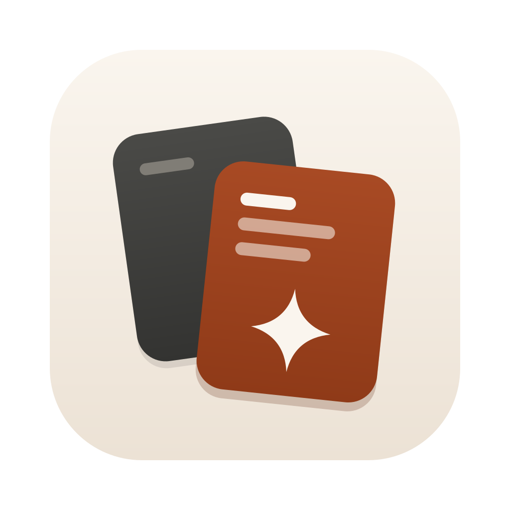
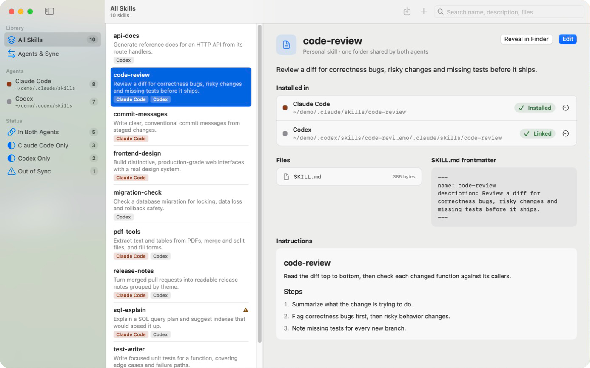

<p align="center">
  
</p>

<h1 align="center">Skills Manager</h1>

<p align="center">A native macOS app for browsing, editing, syncing and importing skills for Claude Code and Codex.</p>



## Features

- See every skill you wrote or installed for Claude Code (`~/.claude/skills`) and Codex (`~/.codex/skills`) in one library, with search across names, descriptions and files.
- Know at a glance whether a skill is in both agents, only one, or out of sync between them.
- Put a skill into the other agent as a symlink, so one edit shows up in both, or as a copy.
- Edit SKILL.md with a live preview, without disturbing frontmatter keys the app doesn't know about.
- Import skills from a GitHub repository, a folder or a ZIP file.
- Removing a skill moves it to the Trash, or removes only the link when it is a symlink.
- Codex built-in skills stay hidden unless you ask for them, and are always read-only.

## Requirements

- macOS 15 or later
- Swift 6.2 (Xcode 26) to build

## Build and run

```bash
Scripts/run.sh
```

This builds a debug app bundle into `build/SkillsManager.app` and launches it.
For an ad-hoc signed release bundle, run `Scripts/package_app.sh release`.
`swift test` runs the core tests.

The app honors `CLAUDE_CONFIG_DIR` and `CODEX_HOME`, so you can point it at a sandbox instead of your real skills.

## Docs

Start at [AGENTS.md](AGENTS.md) for the rules that matter when changing the code, then [docs/README.md](docs/README.md) for architecture and status.

## License

[MIT](LICENSE)
